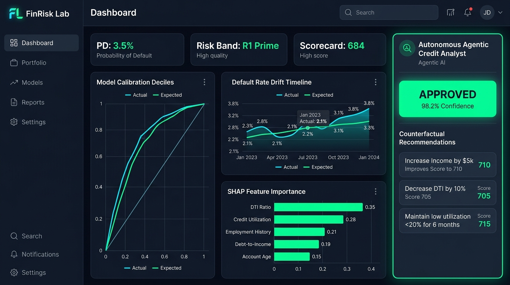
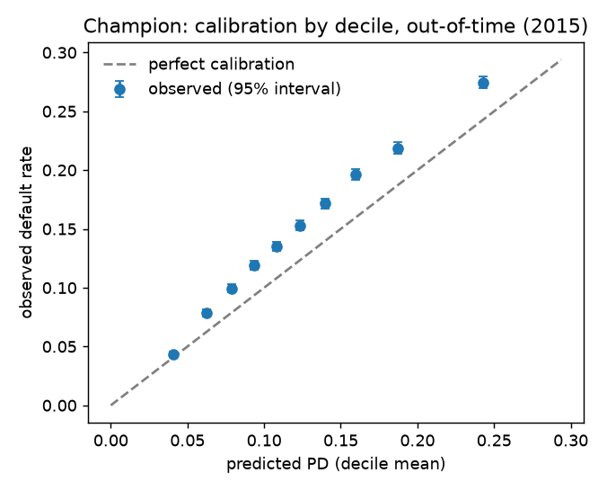
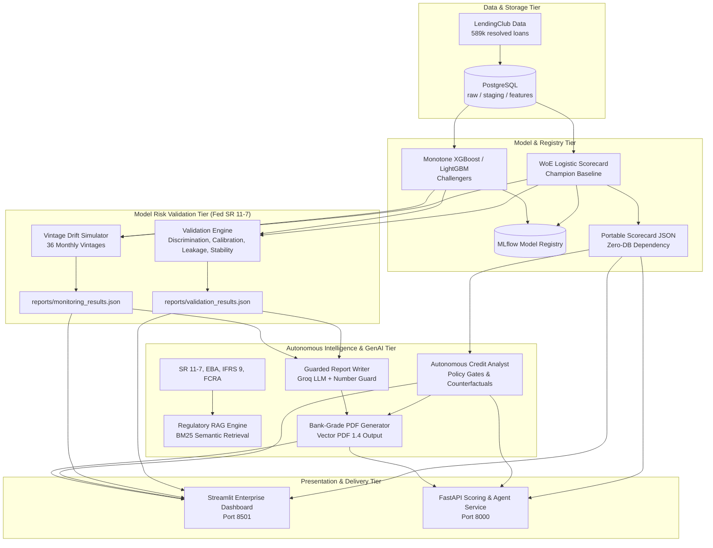

# FinRisk Lab 🏦
### Autonomous Credit Risk Intelligence, Model Risk Governance (SR 11-7) & Agentic Platform

[](https://github.com/Rblaze23/Finrisk/actions/workflows/tests.yml)


**FinRisk Lab** is an institutional-grade credit risk intelligence and model validation platform built on 589,488 resolved loans from LendingClub.

Most credit-default projects stop at *"my model has X% ROC-AUC on a random split"*. Regulated banks ask much harder questions:
- *Can we trust this model with real capital, and under which macroeconomic conditions does it break?*
- *How much does calibration decay over time (the 12-month outcome lag problem)?*
- *Do model explanations satisfy domain monotonicity and FCRA adverse action notice requirements?*
- *Can an autonomous AI agent synthesize audit-grade underwriting memos and prescribe counterfactual paths to approval without hallucinating numbers?*

FinRisk answers these questions end-to-end through a calibrated WoE scorecard, challenger tree ensembles (XGBoost/LightGBM), an independent Model Risk Management (MRM) validation suite (Fed SR 11-7 / EBA compliant), an autonomous **Agentic Credit Analyst**, macro stress testing, and fact-guarded GenAI reporting.

---

<!-- DEMO:START -->
**Live Interactive Dashboard:** *Deploy the dashboard in 1-click or run locally:* `streamlit run streamlit_app.py`
<!-- DEMO:END -->



---

## ⚡ 60-Second Recruiter Tour

If you have 60 seconds to evaluate this project:
1. **Launch the Dashboard**: Run `streamlit run streamlit_app.py` (reads committed lightweight reports; zero database or MLflow required).
2. **🧑‍💼 Test the Agentic Credit Analyst (Tab 1)**:
   - Click **`🟢 Tier 1 Prime (Alex Chen)`** -> Observes instantaneous prime approval (`R1`, 3.5% PD), positive credit mitigants, and zero policy exceptions.
   - Click **`🔴 Distressed Subprime (Taylor Smith)`** -> Observes adverse action decline, policy hard-cutoff breaches (DTI > 43%, bankruptcy flag), and an automated **FCRA Adverse Action Notice** with the top 4 regulatory reason codes.
   - Inspect the **Counterfactual Optimization Engine**: View exact actionable prescriptions to qualify for a better risk band (e.g., pay down $3,800 revolving debt -> upgrades to `R3`, +28 scorecard points).
   - Ask the **Interactive Credit Copilot**: *"Why was this applicant flagged?"*
3. **🛡️ Inspect Model Validation & Calibration (Tab 3)**:
   - Inspect the out-of-time decile calibration curve (loans issued in 2015 vs trained on 2012-13): observe how the model under-predicts default rate during economic seasoning (calibration ratio 1.204).
4. **📈 Stress-Test the Portfolio (Tab 5)**:
   - Move the macroeconomic shock sliders (+150 bps interest rate hike, +2.0% unemployment shock) to observe real-time portfolio PD migration and Expected Credit Loss ($EL = PD \times LGD \times EAD$).
5. **📄 Export Bank-Grade PDFs (Tab 7)**:
   - Click **`Download Model Validation Report (PDF)`** to inspect the official SR 11-7 audit report generated in vector PDF format.

---

<!-- RESULTS:START -->
### Key Empirical Results
*Generated from `reports/*.json`. Out-of-time = loans issued in 2015; models are trained on 2012-2013. 589,488 resolved 36-month loans.*

| | scorecard (champion) | XGBoost (challenger) |
|---|---|---|
| Gini, out-of-time | 0.298 | 0.334 |
| KS, out-of-time | 0.214 | 0.242 |
| Gini, training | 0.295 | 0.403 |
| Calibration ratio, out-of-time (observed / predicted) | 1.204 | 1.187 |
| Predicted vs observed default rate | 12.4% vs 14.9% | 12.5% vs 14.9% |
| Risk bands under-predicted | 5 of 6 | 5 of 6 |
| Calibration slope (1.0 = ideal) | 0.984 | 0.882 |
| Validation verdict (rule-based) | **Approved with conditions** | **Approved with conditions** |

**What the Independent Validation Found:**

1. **Ranking power is stable, probabilities are not.** Out-of-time Gini is 0.298 (scorecard) and 0.334 (XGBoost), yet both models systematically under-predict 2015 defaults: calibration ratios of 1.204 and 1.187 (observed 14.9% against 12.4% / 12.5% predicted).
2. **Input-drift monitoring alone would not have caught it.** Over 36 monthly vintages the score PSI never alerted. The calibration monitor first flagged the 2014-10 vintage, but because outcomes lag by 12 months it was visible only from 2015-10, after 250,990 further loans had been issued.
3. **The model saw improving risk while reality worsened.** Between 2014-01 and 2015-12 the mean predicted PD went from 12.8% to 12.1% while the observed default rate rose from 12.5% to 15.6%, and monthly origination volume grew by a factor of 2.6.
4. **Complexity does not automatically earn deployment.** XGBoost adds +0.036 Gini, but its Gini degrades by -17.0% from training to out-of-time (champion scorecard: rises by +1.1%), and it is **not** recommended to replace the champion: Gini gain is below the materiality threshold of 0.05, and it relies heavily on geographic proxy variables (`addr_state`).
5. **Lagged recalibration repairs only part of the gap.** Fitting an intercept shift on known historical vintages moves the calibration ratio in 2015-12 from 1.226 to 1.119.




<!-- RESULTS:END -->

---

## 🏛️ System Architecture



---

## 🧩 Core Platform Capabilities

### 1. 🧑‍💼 Autonomous Agentic Credit Analyst (`finrisk.agent.credit_analyst`)
- **Archetype Profiles**: 1-click loading for Prime (*Alex Chen*), Near-Prime (*Jordan Taylor*), Borderline Gig Worker (*Morgan Reed*), and Distressed Subprime (*Taylor Smith*).
- **5-Step Autonomous Pipeline**:
  1. *Risk Scoring & Master Scale Mapping*: Probability of Default, calibrated Risk Band (`R1` to `R6`), and Scorecard Rating Points.
  2. *SHAP & Factor Decomposition*: Isolates risk-reducing vs risk-amplifying log-odds contributions.
  3. *Policy & Hard Cutoff Verification*: Evaluates maximum DTI ceilings (43.0% QM limit), FICO minimums, recent delinquency penalties, and bankruptcy flags.
  4. *Counterfactual Optimization Engine*: Solves the minimal required borrower adjustments to upgrade to a target risk tier (e.g. *"Pay down $3,800 revolving balance to reduce DTI from 28.5% to 22.0% -> Moves from R4 to R2, saving ~$1,840 in interest"*).
  5. *FCRA Adverse Action Notice Generator*: Automated, legally compliant adverse action disclosure identifying the top 4 principal reasons for credit conditioning or denial.
- **Interactive Credit Copilot**: Real-time conversational interface to interrogate the agent on reasons, policy exceptions, and vintage default comparisons.

### 2. 🛡️ Institutional Model Risk Validation (Fed SR 11-7 / EBA GL/2017/16)
- **Discrimination**: Gini, Kolmogorov-Smirnov (KS), ROC-AUC across Train (2012-13), Validation (2014), and Out-of-Time test (2015).
- **Calibration by Decile**: Observed default rates plotted against predicted PDs with 95% binomial confidence intervals; calibration slope and intercept tests.
- **Leakage Auditing**: Automated detection of post-origination fields; single-feature Gini spike checks; demonstration leaky benchmark model.
- **Proxy Fairness**: Group calibration deviation checks across employment lengths and geographic residence.

### 3. 🔬 Explanation Evaluation & Governance (`finrisk.explain.evaluation`)
- **Monotonicity Compliance**: Verifies that feature attributions follow domain economic theory (higher FICO strictly decreases default log-odds; higher DTI strictly increases default log-odds).
- **Temporal Attribution Stability**: Spearman rank correlation of feature attributions across data splits (Train to OOT rho = 0.970, Top-5 overlap = 80%).
- **Champion vs Challenger Alignment**: Quantifies attribution divergence between linear Scorecards and Tree Ensembles (XGBoost/LightGBM), identifying non-linear geographic interactions.

### 4. 📈 Portfolio Monitoring & Macroeconomic Stress Testing
- **Vintage Seasoning Analysis**: 36 monthly vintages tracked through the 12-month outcome maturity window.
- **Input vs Outcome Drift Timing**: Demonstrates why input drift (CSI / PSI) is essential as a leading indicator before outcome-based calibration alerts appear.
- **Feature CSI Drilldown**: Interactive CSI trajectory analysis across all 15+ candidate features.
- **Macro Stress Simulator**: Real-time sensitivity simulation under custom macroeconomic scenarios (Unemployment shocks, Fed rate hikes, real income contraction) calculating portfolio Expected Credit Loss ($EL = PD \times LGD \times EAD$).

### 5. 🤖 Guarded GenAI & Regulatory RAG (`finrisk.genai`)
- **Number Guard**: Every number and date generated in LLM prose is deterministically cross-referenced against the raw results JSON. Any draft containing an unsupported figure is rejected, retried, and falls back to deterministic templates if uncorrected.
- **Regulatory RAG**: BM25 / TF-IDF semantic retrieval engine over supervisory documents:
  - Federal Reserve SR 11-7 / OCC 2011-12 (Model Risk Management)
  - EBA/GL/2017/16 (Internal Ratings Based PD/LGD Estimation)
  - IFRS 9 / US GAAP CECL (Impairment & Staging)
  - FCRA 15 U.S.C. § 1681m & ECOA Regulation B (Adverse Action Disclosures)

### 6. 📄 Bank-Grade PDF Report Engine (`finrisk.reports.pdf_generator`)
- Generates official, vector PDF 1.4 documents directly in Python with zero external binary dependencies:
  - **Official Model Validation Report (PDF)**: Executive governance document with calibration decile tables, policy findings, and Number Guard verification seal.
  - **Individual Credit Underwriting Memo (PDF)**: Formal borrower credit committee package with applicant vitals, risk tier, counterfactual prescriptions, and FCRA Adverse Action Statement.

---

## 🚀 Quick Start

### Option A: Local Python Run (Fastest)

```bash
# 1. Clone repository
git clone https://github.com/Rblaze23/Finrisk.git && cd finrisk

# 2. Set up virtual environment
python -m venv .venv
source .venv/bin/activate       # Windows: .venv\Scripts\activate
pip install -r requirements.txt # Dashboard dependencies

# 3. Launch the Streamlit Platform (self-contained from reports/ artifacts)
streamlit run streamlit_app.py
```
*Open http://localhost:8501 to explore the dashboard.*

---

### Option B: Unified Docker Compose (Full Stack)

Launch the Streamlit Dashboard, FastAPI Service, MLflow Model Registry, and PostgreSQL database with a single command:

```bash
docker compose up -d --build
```

| Service | URL | Purpose |
|---|---|---|
| **Streamlit Dashboard** | http://localhost:8501 | Institutional Credit Intelligence & Agent Platform |
| **FastAPI Scoring API** | http://localhost:8000/docs | Scoring, Underwriting Agent & PDF Export Endpoints |
| **MLflow Registry** | http://localhost:5000 | Experiment Tracking & Model Registry |
| **PostgreSQL** | `localhost:5432` | Raw, Staging, and Feature Store Tables |

To tear down: `docker compose down`.

---

### Option C: 1-Click Cloud Deployment

- **Streamlit Community Cloud**:
  1. Fork or push to GitHub.
  2. In [share.streamlit.io](https://share.streamlit.io), connect your repo, set Main file path to `streamlit_app.py`.
  3. (Optional) In app settings, set `GROQ_API_KEY` in Secrets.
- **Render / Railway / Google Cloud Run**:
  - Deploy using the production Dockerfile: `docker/Dockerfile.standalone`.
  - Or use the included blueprint: `render.yaml`.

---

## 🧪 Testing & Validation

The test suite validates data splits, calibration mathematics, PSI/CSI stability, the Number Guard verification loop, FastAPI endpoints, and Streamlit UI components headlessly:

```bash
pytest -v
```

---

## ⚖️ Ethical & Methodological Disclosures

- **Proxy Fairness**: The LendingClub public dataset does not contain protected demographic attributes (race, gender, age). Fairness analyses in this repository are geographic and proxy-based, not a formal legal disparate impact evaluation.
- **Outcome Censoring**: Loans originated in 2016 had not completed their 36-month maturity cycle when data collection ended; their outcomes are censored and used only for input stability monitoring.
- **Institutional Scope**: This is an educational and portfolio demonstration platform designed to illustrate enterprise banking model risk management principles. Not for production credit decisions.

---

## 📜 License & Acknowledgments

- **Code License**: MIT License. See [LICENSE](LICENSE).
- **Dataset**: LendingClub resolved loans 2007-2018Q4 (`wordsforthewise/lending-club` on Kaggle). Respect the original dataset terms.
