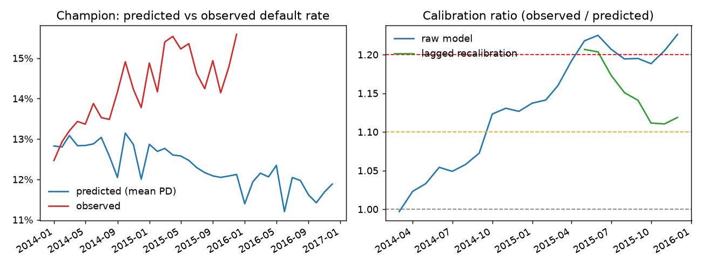
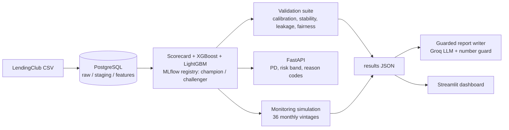

# FinRisk Lab

[](https://github.com/Rblaze23/Finrisk/actions/workflows/tests.yml)


**Credit-risk modelling, validation and monitoring on LendingClub loans.**
Most credit-default projects stop at "my model has X% accuracy". Banks ask a harder question:
*can we trust this model with real money, and where does it break?* FinRisk Lab builds the
models, then validates them the way a bank's model-risk team would: out-of-time testing,
calibration, drift, leakage, explainability, fairness proxies and ongoing monitoring, ending in
an audit-style validation report.

<!-- DEMO:START -->
**Live demo:** *deploy the dashboard (see below) and run* `python -m finrisk.summary --demo-url <your-url>`
<!-- DEMO:END -->


<!-- RESULTS:START -->
### Key results
*Generated from `reports/*.json`. Out-of-time = loans issued in 2015; models are trained on 2012-2013. 589,488 resolved 36-month loans.*

| | scorecard (champion) | XGBoost (challenger) |
|---|---|---|
| Gini, out-of-time | 0.298 | 0.334 |
| KS, out-of-time | 0.214 | 0.242 |
| Gini, training | 0.295 | 0.403 |
| Calibration ratio, out-of-time (observed / predicted) | 1.204 | 1.187 |
| Predicted vs observed default rate | 12.4% vs 14.9% | 12.5% vs 14.9% |
| Risk bands under-predicted | 5 of 6 | 5 of 6 |
| Calibration slope (1.0 = ideal) | 0.984 | 0.882 |
| Validation verdict (rule-based) | **Approved with conditions** | **Approved with conditions** |

**What the validation found**

1. **Ranking power is stable, probabilities are not.** Out-of-time Gini is 0.298 (scorecard) and 0.334 (XGBoost), yet both models under-predict 2015 defaults: calibration ratios of 1.204 and 1.187 (observed 14.9% against 12.4% / 12.5% predicted).
2. **Input-drift monitoring alone would not have caught it.** Over 36 monthly vintages the score PSI never alerted. The calibration monitor first flagged the 2014-10 vintage, but because outcomes lag by 12 months it was visible only from 2015-10, after 250,990 further loans had been issued.
3. **The model saw improving risk while reality worsened.** Between 2014-01 and 2015-12 the mean predicted PD went from 12.8% to 12.1% while the observed default rate went from 12.5% to 15.6%, and monthly origination volume grew by a factor of 2.6.
4. **More complex is not automatically better.** XGBoost adds 0.036 Gini, but its Gini falls by 17.0% from training to out-of-time (champion: rises by 1.1%), and it is **not** recommended to replace the champion: Gini gain of 0.036 is below the materiality threshold of 0.05; new finding not present for the champion: `geographic_importance_share`; new finding not present for the champion: `gini_drop_train_to_oot`; new finding not present for the champion: `importance_rank_corr_champion_vs_challenger_oot`.
5. **Recalibration helps only partly.** A recalibration fitted on 2014 leaves a ratio of 1.126; recalibrating monthly with only outcomes already known moves the ratio in 2015-12 from 1.226 to 1.119.
6. **Proxy fairness checks.** The largest group calibration deviation is 22.1% (emp_length: unknown, fail); geographic inputs carry 0.0% of the champion's importance and 4.6% of the challenger's. The data has no protected attributes, so these are proxy checks only.
7. **Leakage is easy to create and easy to detect.** Adding post-origination fields lifts the out-of-time Gini from 0.298 to 0.998; the production models use none (0 found).



<!-- RESULTS:END -->

## How it works



The scoring pipeline never calls an LLM. GenAI is used only to draft report prose, behind a guard.

### Models

| Model | Role | Why |
|---|---|---|
| WoE logistic-regression scorecard | Champion | What regulated lenders actually deploy: monotone, explainable, easy to audit |
| XGBoost, LightGBM | Challengers | Do they earn their complexity? Monotone constraints, early stopping on the validation year, no class re-weighting so PDs stay real probabilities |

Training uses 36-month loans issued in 2012-2013, validation 2014, **out-of-time test 2015**,
monitoring 2016. Splits are by issue year, never random, and the code refuses overlapping periods.
Loans issued after 2015 had not matured when the data ends, so 2016 outcomes are censored and
are used only for input monitors.

### The validation suite

| Family | Question it answers |
|---|---|
| Discrimination | Gini, KS, AUC by period; Gini loss train to out-of-time; Gini by quarter |
| Calibration | Do predicted PDs match observed default rates? Decile table with confidence intervals, calibration slope, one-sided under-prediction test per risk band, three recalibration methods |
| Stability | PSI of the score; CSI of every input the model uses; default-rate shift |
| Sensitivity | Retrain without inputs whose availability changed between vintages |
| Leakage | No post-origination inputs; no single input suspiciously predictive; a deliberately leaky model to show the effect |
| Explanation stability | Do SHAP / scorecard drivers keep their ranking over time and across models? |
| Fairness (proxy) | Calibration by group; share of importance on geographic variables |
| Monitoring | 36 monthly vintages, outcome lag, alert timing, lagged recalibration |

Every result is `pass`, `warn`, `fail` or `info` under an explicit policy
(`THRESHOLDS` in `src/finrisk/validation/results.py`). The thresholds are analyst choices,
not regulatory limits. Verdicts ("approved with conditions" and so on) and the conditions list are
produced by rules, not by a model.

### The GenAI layer, and why it is guarded

`python -m finrisk.genai.report_writer` writes the validation report. The LLM (Groq, temperature 0)
drafts six prose sections from a facts dictionary. A **number guard** extracts every number and date
from each draft and rejects it if any figure is not in the facts; the draft is retried with the
offending numbers listed, and after three attempts a deterministic template takes over. The
appendix of the report and `reports/validation_report_audit.json` record who wrote what, how many
attempts it took and which numbers were rejected. The guard verifies numbers, not interpretation,
which is why a human should still read the prose. `--no-llm` produces the full report without any API key.

## Quick start

Requires Python 3.12, Docker Desktop, and a free Kaggle account for the data.

```bash
git clone https://github.com/Rblaze23/Finrisk.git && cd finrisk
python -m venv .venv && .venv\Scripts\activate        # macOS/Linux: source .venv/bin/activate
pip install -e .
cp .env.example .env                                  # optional: add GROQ_API_KEY
docker compose up -d                                  # PostgreSQL + MLflow

# download accepted_2007_to_2018Q4.csv.gz from Kaggle (wordsforthewise/lending-club) into data/raw/
python -m finrisk.data.ingest            # add --sample for a fast 10% run
python -m finrisk.data.clean
python -m finrisk.data.splits
python -m finrisk.features.build
python -m finrisk.models.train           # scorecard + XGBoost + LightGBM, logged to MLflow
python -m finrisk.validation.run_validation
python -m finrisk.monitoring.simulate --reference valid
python -m finrisk.models.export          # portable scorecard for the public dashboard
python -m finrisk.genai.report_writer --no-llm
python -m finrisk.summary --readme --cv  # refresh the results above from the JSON files

pytest -q
streamlit run streamlit_app.py           # dashboard
uvicorn finrisk.api.main:app --port 8000 # API, docs at http://localhost:8000/docs
```

The committed `reports/*.json` are enough to run the dashboard without any of the data steps.

### Scoring API

```bash
curl -X POST "http://localhost:8000/score?include_challenger=true" -H "Content-Type: application/json" \
  -d '{"loan_amnt": 15000, "annual_inc": 52000, "fico_score": 672, "dti": 24.5, "home_ownership": "RENT"}'
```

Returns the probability of default, a risk band (R1 to R6) and the top reasons that raise the
applicant's risk, from the champion and optionally the challenger.

### Deploy the dashboard (free)

1. Push the repository to GitHub (the `reports/` JSON files must be committed).
2. On [share.streamlit.io](https://share.streamlit.io) choose the repo, branch `main`, main file `streamlit_app.py`.
3. The root `requirements.txt` installs only the light dashboard dependencies. The dashboard reads
   committed files and needs no database or MLflow.
4. Add the URL here with `python -m finrisk.summary --demo-url <url>`.

Optional Docker for the API and dashboard (not part of the default compose file):
`docker compose -f docker-compose.yml -f docker-compose.app.yml up -d --build`.

## Repository layout

```
src/finrisk/
  data/         ingest (COPY into PostgreSQL), clean (SQL staging + target), time-based splits
  features/     SQL features, WoE binning and Information Value
  models/       scorecard, XGBoost/LightGBM, MLflow training and registry, risk bands, portable export
  explain/      SHAP / scorecard contributions, reason codes
  validation/   calibration, stability, out-of-time, sensitivity, leakage, explanation stability, fairness
  monitoring/   monthly vintages, outcome lag, alert timing, lagged recalibration
  genai/        Groq client, number guard, report writer
  api/          FastAPI scoring service
  dashboard/    Streamlit app
sql/            schema, staging, features, monitoring views
tests/          pytest suite (unit tests, API tests, dashboard tests with Streamlit AppTest)
reports/        results JSON, validation report, figures
```

## Limitations

- Fairness checks are **proxy analyses**: the data has no race, gender or age. This is not a fair-lending assessment.
- One public dataset, one temporal split. Results do not show how the models would behave at another lender or in another cycle.
- 2016 outcomes are censored, so outcome monitors cover 2014-2015 only; the 12-month outcome lag is an assumption.
- `grade`, `sub_grade` and `int_rate` are LendingClub's own underwriting outputs, so the headline models exclude them. A second feature set that includes them is trained and appears in the model comparison, but the validation suite runs on the independent set by default.
- The validation thresholds and the materiality threshold for replacing the champion are policy choices.
- This is a portfolio project, not a production credit model. The API and dashboard say so on every response.

## Data and license

Data: LendingClub accepted loans 2007-2018Q4 from Kaggle (`wordsforthewise/lending-club`). The data is
not redistributed here; download it yourself and respect the dataset's terms. Code: MIT, see `LICENSE`.
