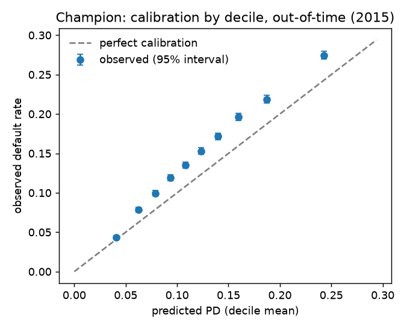
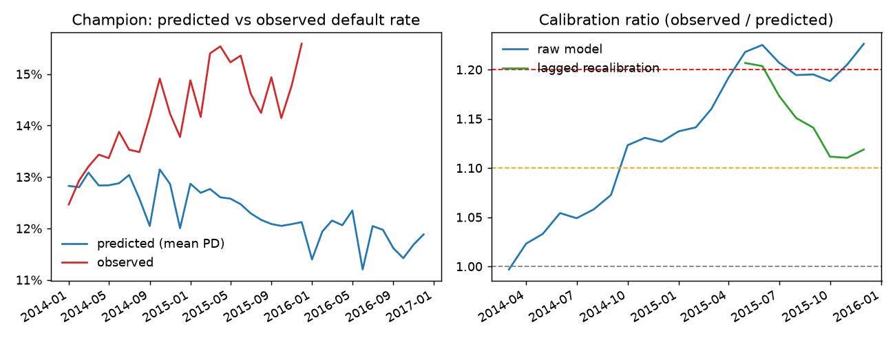

# Independent model validation report: FinRisk Lab credit-risk models
*Validation run `val_20261112_134531` generated 2026-11-12T13:45:31. Report generated 2026-11-13 14:04.*

> Demonstration on public LendingClub data. Not a real credit decision. Verdicts and conditions are rule-based; prose was written under a number-verification guard (Appendix B).

## 1. Executive summary
The champion (WoE logistic-regression scorecard) receives the verdict 'Approved with conditions' and the challenger (XGBoost gradient-boosting model) 'Approved with conditions'. The challenger is not recommended to replace the champion. Out-of-time Gini is 0.298 for the champion and 0.334 for the challenger, but calibration is the main weakness: the observed to predicted default ratio is 1.204 and 1.187 respectively, while the champion's score PSI is only 0.005. The conditions listed below are required before use.

| Model | Role | Verdict | Headline fails | Headline warns |
|---|---|---|---|---|
| scorecard_independent | champion | **Approved with conditions** | 5 | 6 |
| xgboost_independent | challenger | **Approved with conditions** | 4 | 10 |

**Replacement decision:** the challenger is **not** recommended to replace the champion. Reasons: Gini gain of 0.036 is below the materiality threshold of 0.05; new finding not present for the champion: geographic_importance_share; new finding not present for the champion: gini_drop_train_to_oot; new finding not present for the champion: importance_rank_corr_champion_vs_challenger_oot.

## 2. Scope and data
Public LendingClub accepted loans (Kaggle), 36-month loans only. Split by origination year: training 2012-2013, validation 2014, out-of-time test 2015, monitoring 2016 (outcomes censored). Target: charged off or defaulted versus fully paid; unresolved loans are excluded.

- Champion: `scorecard_independent` (registry version 1), WoE logistic-regression scorecard
- Challenger: `xgboost_independent` (registry version 2), XGBoost gradient-boosting model

## 3. Discriminatory power
The champion, a WoE logistic-regression scorecard, reaches a Gini of 0.298 and a KS of 0.214 on the out-of-time sample, against 0.295 in training and 0.293 in validation; its Gini rises by 1.1% between training and out-of-time. The challenger, a XGBoost gradient-boosting model, reaches 0.334 out-of-time, a gain of 0.036 over the champion, but its Gini falls by 17.0% between training and out-of-time. The materiality threshold for replacing the champion is a gain of 0.05.

| Model | Gini train | Gini valid | Gini out-of-time | KS out-of-time |
|---|---|---|---|---|
| champion | 0.295 | 0.293 | 0.298 | 0.214 |
| challenger | 0.403 | 0.334 | 0.334 | 0.242 |

## 4. Calibration
On the out-of-time sample the champion predicts a mean default rate of 12.4% against an observed 14.9%, a calibration ratio of 1.204 (status: fail); the challenger predicts 12.5%, a ratio of 1.187 (status: warn). 5 of 6 risk bands are significantly under-predicted for the champion and 5 for the challenger. The calibration slope is 0.984 for the champion and 0.882 for the challenger. Recalibrating on the validation year improves the champion's ratio only to 1.126 and the challenger's to 1.106.

| Model | Predicted PD % | Observed % | Ratio | Slope | Bands under-predicted |
|---|---|---|---|---|---|
| champion | 12.4 | 14.9 | 1.204 | 0.984 | 5 of 6 |
| challenger | 12.5 | 14.9 | 1.187 | 0.882 | 5 of 6 |

## 5. Stability, sensitivity and leakage
The score distribution is stable for the champion, with a PSI of 0.005 out-of-time and 0.022 in the monitoring year. The default rate rose from 12.7% in training to 14.9% out-of-time. The worst input drift for the champion is a CSI of 1.197 on total_rev_hi_lim; 4 of 11 inputs are above the amber threshold. 6 inputs changed availability between vintages; removing them changes the champion's out-of-time Gini to 0.298 (2.3% relative loss). No post-origination field is used by the champion (0 found); the strongest single input has a Gini of 0.203, whereas a deliberately leaky model reaches 0.998 against 0.298 for the clean model.

## 6. Explainability and fairness
The champion's driver ranking is stable over time, with a rank correlation of 1.0 between training and out-of-time and 5 of the top 5 drivers shared. The challenger's drivers agree only partly with the champion's: a rank correlation of 0.54 and 5 of the top 5 drivers shared. Group calibration deviation from the portfolio for the champion: addr_state (IL: 14.0%, warn); income_quartile (Q4: 17.1%, warn); home_ownership (MORTGAGE: 1.3%, pass); verification_status (Not Verified: 14.3%, warn); emp_length (unknown: 22.1%, fail). Geographic inputs carry 0.0% of the champion's importance and 4.6% of the challenger's. The data contains no protected attributes, so these are proxy checks only.

## 7. Monitoring
For the champion, the score PSI never alerted and the Gini monitor never alerted. The calibration monitor first raised an alert on the 2014-10 vintage, visible from 2015-10 because outcomes lag by 12 months, and first turned red on the 2015-05 vintage. Between the first deteriorating vintage and the moment the alert became visible, 250,990 loans were issued. The mean predicted PD moved from 12.8% to 12.1% while the observed default rate moved from 12.5% to 15.6%, and monthly volume grew by a factor of 2.6. A recalibration using only outcomes already known reduces the calibration ratio in 2015-12 from 1.226 to 1.119, which narrows the gap without closing it.

## 8. Findings and conditions
### Findings (warn / fail, headline tests)
| Model | Test | Metric | Value | Status |
|---|---|---|---|---|
| scorecard_independent (champion) | calibration | oot_calibration_ratio | 1.204 | fail |
| scorecard_independent (champion) | calibration | oot_bands_underpredicted | 5 | fail |
| scorecard_independent (champion) | fairness | oot_group_calibration_dev_emp_length | 0.221 | fail |
| scorecard_independent (champion) | stability | csi_max_used_feature_train_to_valid | 1.192 | fail |
| scorecard_independent (champion) | stability | csi_max_used_feature_train_to_oot | 1.197 | fail |
| scorecard_independent (champion) | fairness | oot_group_calibration_dev_addr_state | 0.140 | warn |
| scorecard_independent (champion) | fairness | oot_group_calibration_dev_income_quartile | 0.171 | warn |
| scorecard_independent (champion) | fairness | oot_group_calibration_dev_verification_status | 0.143 | warn |
| scorecard_independent (champion) | recalibration | intercept_oot_calibration_ratio | 1.126 | warn |
| scorecard_independent (champion) | recalibration | platt_oot_calibration_ratio | 1.125 | warn |
| scorecard_independent (champion) | recalibration | isotonic_oot_calibration_ratio | 1.125 | warn |
| xgboost_independent (challenger) | calibration | oot_bands_underpredicted | 5 | fail |
| xgboost_independent (challenger) | explanation_stability | importance_rank_corr_champion_vs_challenger_oot | 0.542 | fail |
| xgboost_independent (challenger) | stability | csi_max_used_feature_train_to_valid | 1.192 | fail |
| xgboost_independent (challenger) | stability | csi_max_used_feature_train_to_oot | 1.197 | fail |
| xgboost_independent (challenger) | calibration | oot_calibration_ratio | 1.187 | warn |
| xgboost_independent (challenger) | calibration | valid_calibration_slope | 0.885 | warn |
| xgboost_independent (challenger) | calibration | oot_calibration_slope | 0.882 | warn |
| xgboost_independent (challenger) | fairness | oot_group_calibration_dev_addr_state | 0.159 | warn |
| xgboost_independent (challenger) | fairness | oot_group_calibration_dev_income_quartile | 0.119 | warn |
| xgboost_independent (challenger) | fairness | geographic_importance_share | 0.046 | warn |
| xgboost_independent (challenger) | out_of_time | gini_drop_train_to_oot | 0.170 | warn |
| xgboost_independent (challenger) | recalibration | intercept_oot_calibration_ratio | 1.106 | warn |
| xgboost_independent (challenger) | recalibration | platt_oot_calibration_ratio | 1.104 | warn |
| xgboost_independent (challenger) | recalibration | isotonic_oot_calibration_ratio | 1.105 | warn |

### Conditions for use (rule-based)
1. Recalibrate the probabilities of default before use and re-estimate calibration at least quarterly, tracking observed against predicted default rates by origination vintage. *(applies to: challenger, champion; triggered by: oot_bands_underpredicted, oot_calibration_ratio)*
2. Re-base the stability reference population on a recent matured sample, and review inputs whose availability changed between vintages (see the stability section). *(applies to: challenger, champion; triggered by: csi_max_used_feature_train_to_oot, csi_max_used_feature_train_to_valid)*
3. Investigate the groups with the largest calibration deviation and document a justification or a remediation. *(applies to: challenger, champion; triggered by: oot_group_calibration_dev_addr_state, oot_group_calibration_dev_emp_length, oot_group_calibration_dev_income_quartile, oot_group_calibration_dev_verification_status)*
4. Obtain legal and compliance review of geographic inputs, or remove them, before any deployment. *(applies to: challenger; triggered by: geographic_importance_share)*
5. Reduce overfitting (stronger regularisation or simpler structure) and re-test calibration slope. *(applies to: challenger; triggered by: gini_drop_train_to_oot, oot_calibration_slope, valid_calibration_slope)*
6. Document why the challenger relies on different drivers than the champion before it is considered for replacement. *(applies to: challenger; triggered by: importance_rank_corr_champion_vs_challenger_oot)*
7. Add leading-indicator monitors (origination volume growth, mix shifts) because outcome-based calibration monitoring only alerts after the outcome lag. *(applies to: champion, challenger; triggered by: monitoring simulation)*

## 9. Limitations
- Fairness checks are proxy analyses: the data contains no race, gender or age.
- Outcomes of 2016 originations are censored, so outcome-based monitoring covers 2014-2015 only.
- The validation policy thresholds (Appendix A) are analyst choices, not regulatory limits.
- Results come from one public dataset with one temporal split; they do not establish how the models would behave at another lender or in another cycle.
- The number guard verifies figures, not interpretation; a human reviewer should read the prose.

## Appendix A. Validation policy (thresholds)
| Check | Warn | Fail |
|---|---|---|
| calibration_ratio_dev | 0.1 | 0.2 |
| calibration_slope_dev | 0.1 | 0.25 |
| band_underprediction | 1 | 3 |
| gini_drop_relative | 0.1 | 0.2 |
| gini_floor | 0.25 | 0.15 |
| psi | 0.1 | 0.25 |
| vintage_gini_loss | 0.03 | 0.1 |
| single_feature_gini | 0.4 | 0.5 |
| explanation_rank_corr | 0.8 | 0.6 |
| fairness_group_dev | 0.1 | 0.2 |
| geo_importance_share | 0.02 | 0.05 |

## Appendix B. How this report was generated
- Verdicts, conditions, tables and figures: deterministic code from `validation_results.json` and `monitoring_results.json`.
- Prose: deterministic templates (no LLM was used); every number comes straight from the results files.

| Section | Written by | Attempts | Numbers rejected before acceptance |
|---|---|---|---|
| Executive summary | template | 0 | 0 |
| Discriminatory power | template | 0 | 0 |
| Calibration | template | 0 | 0 |
| Stability, sensitivity and leakage | template | 0 | 0 |
| Explainability and fairness | template | 0 | 0 |
| Monitoring | template | 0 | 0 |
